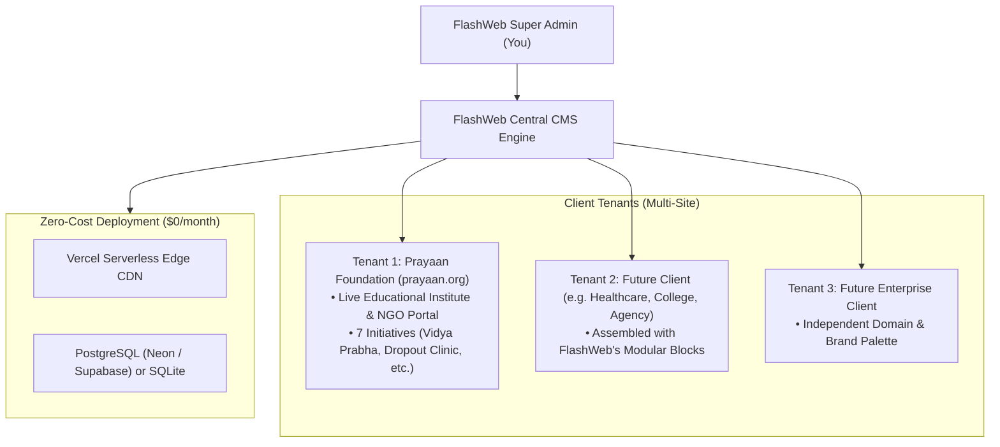

# FlashWeb: Multi-Tenant Website & CMS Engine

**FlashWeb** is an ultra-fast, multi-tenant website platform and headless CMS engine built with **Next.js 15 (App Router)**, **Payload CMS 3.x**, and **Tailwind CSS**. It is designed for agencies, SaaS builders, and multi-organization setups to launch and manage modern, high-converting websites for educational institutions, businesses, clinics, and NGOs from a single codebase and database.

**Flagship Client Site #1**: [Prayaan Foundation](https://prayaan.org) (Educational NGO & Institute in Kishanganj, Bihar).

---

## Architecture: Why FlashWeb?



---

## Features

### 1. Reusable "Lego Block" System (Build Any Website in Minutes)
Instead of hardcoding single-purpose templates, FlashWeb uses a library of modular page blocks:
* **HeroBlock**: Impactful headlines, call-to-actions, and background treatments.
* **StatsBlock**: Live counters, milestones, and audit proofs.
* **ContentBlock**: Rich-text narrative sections with Lexical support.
* **CallToActionBlock**: Lead capture banners and appointment/donation drivers.
* **Dynamic Collections**: `Tenants`, `Users`, `Programs`, `Posts`, `Media`, and `Inquiries`.

### 2. Client Staff Portal (`/admin`)
* Each client's team (e.g., Prayaan Foundation staff) gets a dedicated, role-restricted dashboard at `/admin` to update text, post announcements, publish events, and view incoming student applications without touching any code.
* **Pre-seeded Admin**:
  * **Email**: `admin@prayaan.org`
  * **Password**: `PrayaanAdmin2026!`

### 3. Flagship Showcase: Prayaan Foundation
Client #1 is fully implemented with:
* Full educational institute portal (Home, About Us, 7 Initiatives, News & Field Drives, Contact & Admissions).
* Real extracted history (founded Nov 2017, Societies Registration Act), contact info (Kishanganj, Bihar; `info@prayaan.org`), and verified impact metrics (15,000+ children rallied, 1,850+ dropouts reinstated).
* Interactive application form routing directly into the `inquiries` database.

---

## Tech Stack

* **Framework**: Next.js 15 (App Router, Server Components)
* **CMS**: Payload CMS 3.x (Lexical editor, native Next.js integration)
* **Styling**: Tailwind CSS + Lucide React Icons
* **Database**:
  * **Local Development**: SQLite (zero setup, `./local.db`)
  * **Production (Vercel)**: Serverless PostgreSQL (Neon, Supabase, or Vercel Postgres)
* **Hosting**: Vercel (100% Free Hobby Tier, global edge caching)

---

## Quick Start (Local Development)

### 1. Clone & Install
```bash
git clone https://github.com/ithiyacloud2/flashweb.git
cd flashweb
pnpm install
```

### 2. Run Database Seeding
```bash
npx tsx src/seed.ts
```

### 3. Start Development Server
```bash
pnpm dev
```
Open:
* **Frontend Site (Prayaan Client)**: [http://localhost:3000](http://localhost:3000)
* **Staff CMS Portal**: [http://localhost:3000/admin](http://localhost:3000/admin)

---

## Deploying to Vercel ($0 Free Tier)

1. Open **[vercel.com/new](https://vercel.com/new)** and import the **`ithiyacloud2/flashweb`** repository.
2. In the **Environment Variables** section on Vercel, set:
   * `PAYLOAD_SECRET`: (Your 32-character secret)
   * `DATABASE_URI`: (Your free Neon or Supabase connection string)
   * `NEXT_PUBLIC_SERVER_URL`: `https://your-domain.vercel.app`
3. Click **Deploy**.

---

## License
MIT License • Created with FlashWeb Engine.
